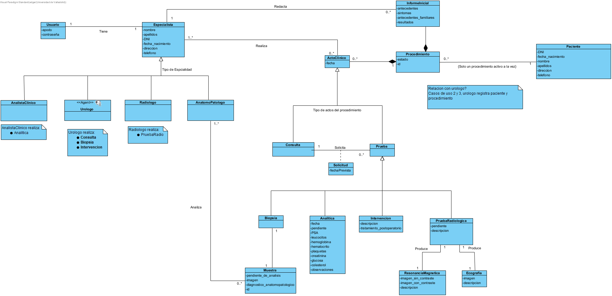

# Práctica DIAS – Grupo Foxtrot

## Integrantes
- Edgar Santiesteban Mendo
- Marcos Palatino Álvarez Fulconis
- Hugo Adan de la Fuente

## Repositorio
URL del repositorio GitLab:
    https://gitlab.inf.uva.es/edgsant/dias2526-foxtrot

## Estructura y trabajo
La rama main tendrá temporalmente la estructura base de la practica (carpetas y readme sin completar)

Para trabajar correctamente en GitLab, cosas a recordar:
### Trabajo con ramas
Se recomienda no trabajar directamente sobre la rama principal (main o master). Cada cambio
relevante debería desarrollarse en una rama específica, creada a partir de la rama principal.
Conviene utilizar nombres de rama descriptivos y homogéneos. Por ejemplo:
- feature/cu01-login
- feature/modelo-dominio
- feature/api-pacientes
- fix/validacion-fecha
- docs/readme
- test/cu03-procedimiento
La idea es que cada rama represente una tarea o cambio acotado, de forma que su propósito sea fácil de entender
### Uso de merge requests
La integración del trabajo en la rama principal debería realizarse preferentemente mediante
merge requests en GitLab. No se recomienda hacer push directo a la rama principal salvo en casos
excepcionales y justificados.
Cada merge request debería:
- tener un título claro y descriptivo;
- agrupar cambios relacionados entre sí;
- incluir una breve explicación de lo realizado;
- permitir que otro integrante del grupo revise el trabajo antes de integrarlo.
Siempre que sea posible, se recomienda que las merge requests sean pequeñas y frecuentes, en lugar de acumular muchos cambios en una única integración final.
###  Revisión del trabajo
El uso de GitLab debe reflejar una colaboración real entre los miembros del grupo. Por ello, se
recomienda revisar el trabajo de los compañeros antes de aceptar una merge request, comprobando
al menos:
- que el cambio tiene sentido respecto al caso de uso o artefacto trabajado;
- que no rompe la estructura general del proyecto;
- que mantiene la coherencia con el análisis, el diseño y la implementación;
- que la documentación y los nombres utilizados son comprensibles.
No se busca una revisión exhaustiva como en un entorno profesional, pero sí una evidencia
mínima de trabajo coordinado y validación entre iguales.
### Mensajes de commit
<tipo>: <descripción en minúsculas y lenguaje imperativo>
- feat: nueva funcionalidad;
- fix: corrección de errores;
- docs: cambios en documentación;
- test: incorporación o modificación de pruebas;
- refactor: reorganización interna del código sin cambiar el comportamiento esperado;
- chore: tareas auxiliares de configuración o mantenimiento

---

# 1. Introducción
(Breve descripción del sistema y del objetivo de la práctica.)
El proyecto a desarrollar consiste en un sistema web para la gestión de pacientes en una clínica urológica. 
El sistema tratará el seguimiento y trazabilidad del expediente de un paciente desde su registro, sus consultas y las pruebas médicas solicitadas junto a aquellos especialistas que las realizaron.
El objetivo de esta practica es aplicar los conocimientos de la asignatura Diseño, Integración y Adaptación de Software para un sistema y aplicando los 5 flujos de trabajo; Requisitos, Análisis, Diseño, Implementación y Pruebas.
Se partirá de un documento que ya recoge el análisis del workflow de Requisitos, en docs/requisitos/documento-de-requisitos.

---

# 2. Alcance del trabajo
Este proyecto solo tratará un subconjunto acotado de funcionalidad del sistema clínico descrito en el enunciado para los flujos de trabajo de Análisis, Diseño e Implementación.

## Funcionalidad trabajada
El sistema solo abarcará los siguientes casos de uso:
- CU01 - Iniciar sesión
- CU02 - Registrar paciente
- CU03 - Crear procedimiento clínico
- CU04 - Registrar informe clínico inicial
- CU05 - Registrar resultados de analítica
- CU06 - Consultar procedimiento clínico
- CU07 - Dar de alta al paciente

## Decisiones sobre el alcance funcional
Para simplificar el sistema a desarrollar, se han tomado las siguientes decisiones:
- Gestión de Especialistas: Todos los especialistas estarán ya dados de alta en el sistema, no se tratará las funcionalidades de dar de alta o gestionar sus cuentas.
- Gestión de citas: El sistema no gestiona las citas o agendas de los pacientes, se asumirá que para las consultas o pruebas el paciente ya fue citado externamente.
- Almacenamiento de pruebas: El sistema no gestiona la localización del almacenamiento de muestras de biopsias.

# 3. Modelo de dominio
## 3.1 Clases identificadas
- Paciente: El paciente que tiene o ha tenido un procedimiento y se le ha dado de alta en nuestro sistema. Contiene los datos personales de dicho paciente.
- Procedimiento: Clase 'contenedor' del historial del paciente. Contiene toda la información relacionada con un procedimiento del paciente; consultas, pruebas, informes, etc. El paciente solo puede tener un procedimiento activo en un momento dado.
- InformeInicial: Documento creado en la primera consulta cuando se inicia un procedimiento del paciente. Recoge antecedentes y analisis fisico inicial del paciente.
- ActoClinico: Clase abstracta que agrupa los distintos actos a los que se someterá un paciente durante un procedimiento, las consultas y las pruebas, con un unico atributo fecha para facilitar la trazabilidad temporal de nuestro sistema y la visión global de los actos realizados durante un procedimiento.
- Consulta: Interacción entre el paciente y un urólogo donde se evalúa al paciente y se toman decisiones clínicas (dar de alta o realizar una prueba)
- Prueba: Superclase que agrupa los distintos procedimientos clínicos a los que se puede someter un paciente durante su Procedimiento, junto a la consulta que solicitó la prueba.
- Analitica: Prueba clínica donde un AnalistaClinico recoge los valores de los datos obtenidos en laboratorio sobre el paciente. 
- PruebaRadiologica: Prueba clínica donde un Radiologo recoge los resultados de dos artefactos clínicos realizados sobre el paciente; la ResonanciaMagnetica y la Ecografia.  
- ResonanciaMagnetica: Artefacto clinico de una PruebaRadiologica.
- Ecografia: Artefacto clinico de una PruebaRadiologica.
- Biopsia: Prueba clínica realizada por un urólogo donde se le toman muestras a un paciente.
- Muestra: Muestras obtenidas durante una biopsia que deberán ser diagnositcadas por un anatomopatólogo. 
- Intervencion: Prueba clínica realizada por un Urólogo donde se realiza una cirugía quirúrgica al paciente

- Especialista: Superclase que agrupa todo el personal de la clínica. 
- Usuario: Usuario ya dado de alta que usará el especialista para acceder al sistema
- AnalistaClinico: Tipo de especialista encargado de recoger los datos en las Analiticas
- AnatomoPatologo: Tipo de especilista encargado de analizar las Muestras tomadas en las Biopsias
- Radiologo: Tipo de especialista encargado de tomar y analizar las PruebasRadiologicas y sus artefactos.
- Urologo: Tipo de especialista encargado de las consultas y seguimiento del paciente.

## 3.2 Diagrama de dominio

## 3.3 Comentarios
Durante el análisis del modelo de dominio se han tomado las siguientes decisiones para garantizar el cumplimiento de las reglas de negocio y simplificar el diseño y arquitectura del sistema:
- Superclase ActoClinico: Para evitar que un procedimiento clinico tenga diversas relaciones 'dispersas' entre consultas y pruebas, se ha modelado para que Procedimiento tenga una relación única con cada ActoClínico relevante durante el Procedimiento del paciente, asegurando que Procedimiento tenga el historial global y ordenado.
- Separación de Consulta y Prueba: Al requerir trazabilidad entre una Prueba y quien la realizó, y la consulta y el urólogo que la solicitó, se han modelado las dos clases Consulta y Prueba con una asociación entre ellas.
- Relación general entre especialista y ActoClinico vs especificacion:   
---
# 4. Modelo de análisis
## 4.1 Casos de uso
(Descripción breve.)
- CU01 - Iniciar Sesión: Este caso recoge el flujo de trabajo de cuando un especialista (previamente registrado en el sistema) intenta iniciar sesión con su usuario y contraseña. Al realizarse correctamente el sistema debe identificar que especialista es el asociado a esa cuenta para darle el acceso a las funciones relacionadas con su rol, y en caso erroneo al introducir credenciales no válidas el se mostrará un error y NO se iniciará sesión.  
- CU02 - Registrar Nuevo Paciente: Este caso recoge el flujo de trabajo en el que un Urólogo con sesión iniciada previamente en el sistema, de de alta en nuestro sistema a un nuevo paciente. Una vez introducidos de manera correcta los datos asociados al paciente, quedará registrada su ficha en el sistema con los datos personales de ese paciente. En caso de confundirse el Urólogo al introducirlos, se mostrará un mensaje de error y deberá volver a introducirlos correctamente
## 4.2 Clases de análisis
(Explicación de su papel.)
- CU01 - Iniciar sesión

El diagrama BCE de este caso de uso se compone del Actor Especialista, aquel que quiere iniciar sesion, relacionado con la clase Boundary AccesoInicioSesion que se encarga de la interacción entre el actor y el sistema, la clase Controller GestorInicioSesion y las clases Entity Usuario que es el usuario del sistema del Especialista y la Entity Especialista, que es la información asociada a dicho usuario sobre el especialista (datos personales, rol, etc)

El diagrama BCE de este caso de uso se compone del Actor Urólogo, aquel que quiere registrar al paciente, relacionado con la clase Boundary AccesoRegistroPaciente que se encarga de la interacción entre el actor y el sistema, la clase Controller GestorRegistroPaciente y la clase Entity Paciente.
## 4.3 Diagramas de secuencia
- CU01 - Iniciar sesión:

- CU02 - Registrar paciente:

## 4.4 Comentarios
Decisiones importantes.
---
# 5. Diseño
## 5.1 Arquitectura
Describir la arquitectura del sistema basada en la separación en capas (domain, application, inf- el papel de cada capa)
- las responsabilidades principales
- cómo se relacionan entre sí
## 5.2 Diagrama de arquitectura

## 5.3 Diseño de clases

## 5.4 Decisiones de diseño
Describir las principales decisiones de diseño adoptadas, incluyendo:
- uso de patrones (si aplica)
- asignación de responsabilidades entre clases y capas
- organización del código
Por cada decisión relevante, justificar:
- qué problema resuelve
- cómo se relaciona con los casos de uso y el modelo de análisis
- qué impacto tiene en la implementación
---
# 6. Implementación
## 6.1 Estructura del código
Explicación de carpetas.
## 6.2 Tecnologías
Lenguaje, librerías, herramientas.
## 6.3 Descripción
Cómo se ha implementado la funcionalidad.
## 6.4 Ejecución
### Instalación
```bash
poetry install
poetry run python -m app.main #Este es un ejemplo
```
# 7. Pruebas
## 7.1 Estrategia
Qué se prueba y por qué.
## 7.2 Tests implementados
Descripción breve.
## 7.3 Ejecución
```bash
poetry run pytest # Esto es un ejemplo
```
## 7.4 Cobertura (opcional)
# 8. Trazabilidad
| **Caso de uso** | **Dominio** | **Análisis** | **Diseño** | **Código** | **Test** |
| ------------- | ----------- | ------------ | ---------- | ---------- | -------------- |
| CUxx | Clase X | Secuencia Y | Servicio Z | modulo.py | test_modulo.py |
# 9. Planificación
Explicar cómo se ha organizado el trabajo durante las 8 semanas.
# 10. Conclusiones
- Dificultades
- Decisiones
- Aprendizaje
- Mejoras futuras
# Anexo I
## Videodefensa
<Enlace a la videodefensa>